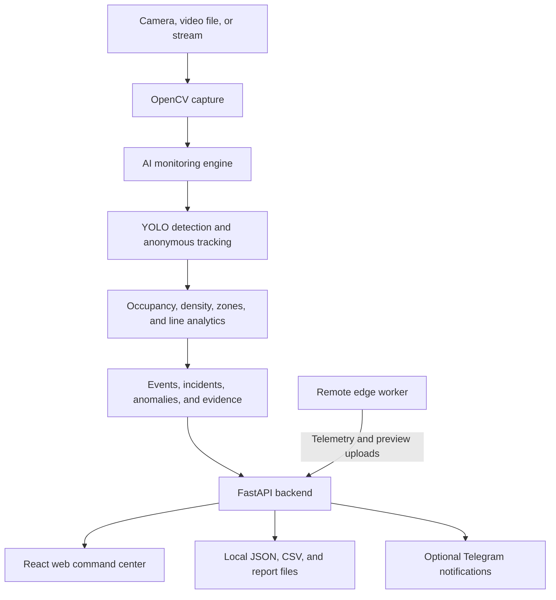

# CrowdVision AI Backend

**AI-powered crowd monitoring, occupancy intelligence, incident detection, and camera operations.**

CrowdVision AI is a computer-vision platform designed to help operators understand activity in monitored spaces. The backend combines video processing, object detection, anonymous tracking, operational analytics, incident and anomaly workflows, evidence handling, and a REST API for the web command center.

## Project repositories

- **Backend:** [crowdvision-backend](https://github.com/refino17/crowdvision-backend)
- **Frontend:** [crowdvision-frontend](https://github.com/refino17/crowdvision-frontend)

## Product preview

The operator-facing web command center is maintained in the separate frontend repository.

<p align="center">
  <a href="https://github.com/refino17/crowdvision-frontend">
    
  </a>
</p>

[View the frontend repository and command dashboard screenshots](https://github.com/refino17/crowdvision-frontend#product-screenshots).

## Overview

The backend provides the API and computer-vision processing services used by the CrowdVision AI web application. It manages monitoring-engine processes, camera sources, live-frame delivery, events, analytics, alerts, reports, evidence, and remote edge-worker communication.

The normal local workflow is to start the FastAPI service and then open the frontend. The dashboard can start, stop, and restart the AI monitoring engine through the API.

## Core capabilities

- **Video-based crowd detection:** processes camera or video input with OpenCV and an Ultralytics YOLO model.
- **Anonymous tracking:** follows detected people for operational counting and movement analysis without requiring identity recognition.
- **Occupancy and density intelligence:** calculates crowd-related metrics for monitored areas.
- **Zone and line analytics:** supports configured monitoring zones and entry/exit line counting.
- **Incident and anomaly workflows:** records and exposes detected events for operator review.
- **Camera health and source management:** supports local devices, video files, stream sources, and remote edge workers.
- **Live monitoring support:** provides live video/frame endpoints for the frontend.
- **Analytics and prediction endpoints:** supplies summary metrics, chart data, alert distribution, and prediction information.
- **Evidence and reporting:** exposes evidence records and report workflows, including CSV and Excel exports.
- **Telegram notifications:** optional Telegram alert delivery using locally configured credentials.
- **Audit logging:** records operational and security-related actions in a local file-based audit log.
- **Performance controls:** includes configurable performance modes intended to help the application run on different hardware.

## Architecture



The web interface and backend are maintained in separate repositories. The backend API is defined in `backend/api.py`; the main monitoring engine is in `app/main.py`; and the remote edge worker is in `app/edge_worker.py`.

## Technology stack

| Area | Technology |
|---|---|
| API | FastAPI |
| ASGI server | Uvicorn |
| Computer vision | OpenCV |
| Object detection | Ultralytics YOLO |
| Deep learning runtime | PyTorch |
| Data processing | NumPy, Pandas |
| Reports and exports | ReportLab, OpenPyXL |
| System monitoring | psutil |
| Upload handling | python-multipart |

## Repository structure

```text
crowdvision-backend/
├── app/
│   ├── main.py                 # Main AI monitoring engine
│   ├── edge_worker.py          # Remote/edge camera worker
│   ├── detector.py             # Detection integration
│   ├── camera.py               # Camera capture and handling
│   ├── occupancy.py            # Occupancy tracking
│   ├── density.py              # Crowd density calculations
│   ├── zones.py                # Monitoring zones
│   ├── line_counter.py         # Entry/exit line counting
│   ├── incident.py             # Incident workflows
│   ├── anomaly.py              # Anomaly workflows
│   ├── audit.py                # Audit logging
│   ├── telegram_alerts.py      # Telegram integration
│   └── report_generator.py     # Report generation
├── backend/
│   └── api.py                  # FastAPI application and routes
├── data/                       # Local runtime data (created as needed)
├── requirements.txt
└── .gitignore
```

Some modules and supporting files are omitted from this overview for readability.

## Getting started

### Prerequisites

- Python 3.10 or newer recommended.
- `pip` and Python virtual-environment support.
- A compatible camera, video file, or stream source.
- Sufficient memory and processing capacity for the selected model and performance mode.

PyTorch and computer-vision dependencies can be hardware- and platform-sensitive. If the default PyTorch installation is unsuitable for your machine, use the official [PyTorch installation selector](https://pytorch.org/get-started/locally/).

### 1. Clone the backend

```bash
git clone https://github.com/refino17/crowdvision-backend.git
cd crowdvision-backend
```

### 2. Create and activate a virtual environment

```bash
python3 -m venv .venv
source .venv/bin/activate
```

On Windows PowerShell:

```powershell
python -m venv .venv
.venv\Scripts\Activate.ps1
```

### 3. Install dependencies

```bash
python -m pip install --upgrade pip
pip install -r requirements.txt
```

### 4. Start the API

Run this command from the repository root:

```bash
python -m uvicorn backend.api:app --host 127.0.0.1 --port 8000
```

The API is then available at:

- API base: `http://127.0.0.1:8000`
- Interactive API documentation: `http://127.0.0.1:8000/docs`

### 5. Start the frontend

Follow the setup instructions in the [CrowdVision AI frontend repository](https://github.com/refino17/crowdvision-frontend). The current frontend configuration expects the backend at `http://127.0.0.1:8000`.

Once both services are running, open the frontend and use the dashboard controls to select a camera source and start monitoring.

## Configuration

Optional settings are read from the local environment. Keep real credentials in a local `.env` file or process environment; **never commit secrets to GitHub**.

### Telegram alerts

The Telegram integration uses these environment variables:

- `TELEGRAM_ALERTS_ENABLED`
- `TELEGRAM_BOT_TOKEN`
- `TELEGRAM_CHAT_ID`
- `TELEGRAM_MIN_SEVERITY`
- `TELEGRAM_COOLDOWN_SECONDS`

### Remote edge workers

- `CROWDVISION_EDGE_API_KEY` — optional shared key used by the remote edge upload endpoints.
- The worker sends the key using the `X-CrowdVision-Edge-Key` request header when configured.

### Performance and engine modes

The application also reads:

- `CROWDVISION_PERFORMANCE_MODE`
- `CROWDVISION_ENGINE_MODE`
- `CROWDVISION_HEADLESS`
- `CROWDVISION_LOW_RESOURCE`

Actual values depend on the local machine and the desired monitoring setup.

## API areas

The API includes route groups for:

- Health and system status.
- Monitoring-engine lifecycle and performance settings.
- Live video and latest-frame access.
- Dashboard summaries, events, charts, and tracking information.
- Incidents and anomalies.
- Camera health and camera-source profiles.
- Video/device/stream source management.
- Remote edge-worker status, control, telemetry, and previews.
- Reports, CSV exports, and Excel exports.
- Evidence and notifications.
- Telegram status and test alerts.
- Security status and audit logs.

FastAPI's interactive documentation at `/docs` provides the available routes and request schemas for the running version.

## Runtime data and model files

Generated reports, events, audit records, camera state, edge telemetry, uploaded media, evidence, and other runtime artifacts are stored locally under `data/`.

Runtime data, local camera profiles, model weights, and test footage are intentionally excluded from the Git repository. A fresh clone therefore does not contain personal camera configuration, local test videos, or downloaded model weights. Configure a camera or provide a suitable video source locally before starting a monitoring session.

The current implementation uses **file-based storage**, including JSON and CSV files. PostgreSQL is not currently implemented.

## Current scope and deployment note

CrowdVision AI is presented here as an actively developed engineering and portfolio project. The current frontend defaults to a local backend URL, and the backend uses local file-based runtime storage. The supplied API implementation does not provide dashboard-wide administrator authentication. The optional edge shared key should not be interpreted as protection for every API route.

Before exposing the application to the public internet or using it as a production multi-user service, add and validate an appropriate authentication, authorization, transport-security, and deployment configuration.

## Related project

The operator-facing web application is documented in the [CrowdVision AI Frontend repository](https://github.com/refino17/crowdvision-frontend).
